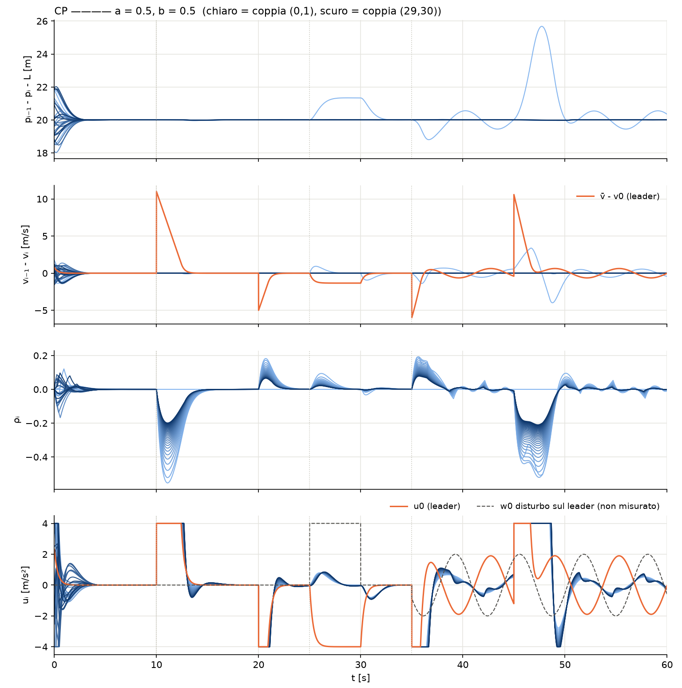
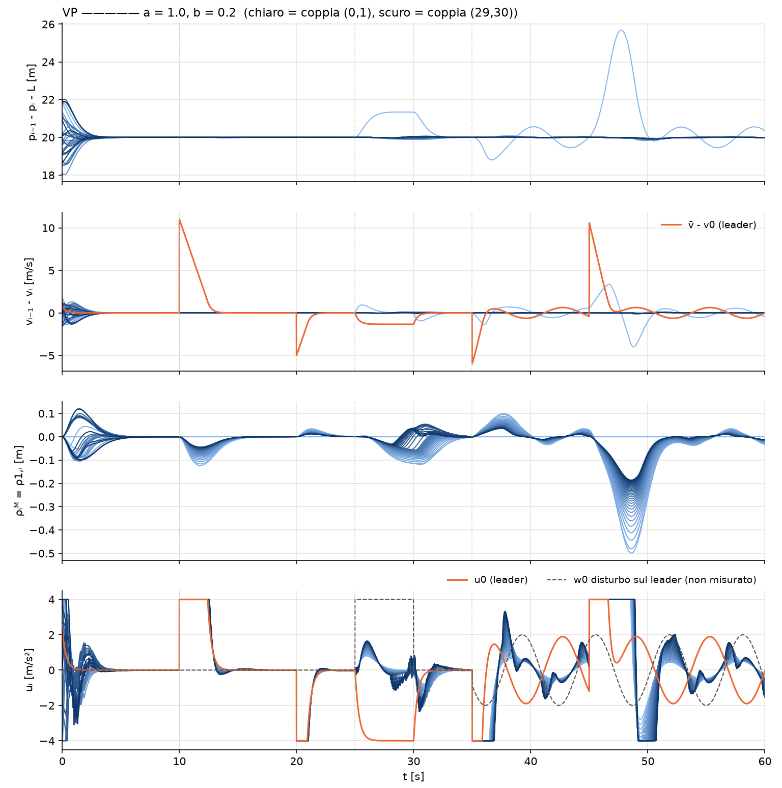

# mesoscopic-platoon-sumo

Ambiente di simulazione per il controllo longitudinale di plotoni di veicoli autonomi connessi, basato sul simulatore di traffico [SUMO](https://eclipse.dev/sumo/) e su script Python collegati con l'interfaccia TraCI.

Nell'ambiente sono implementati i controllori mesoscopici di Mirabilio et al. (2021), a spaziatura costante (CP) e a spaziatura variabile (VP). Oltre alle misure sul veicolo davanti, questi controllori usano un'informazione macroscopica, cioè la media e la deviazione standard degli errori di tutti i veicoli più avanti nel plotone.

Codice della tesi di laurea triennale in Ingegneria Informatica e Automatica, *Sviluppo di un ambiente simulativo per il test di metodologie di controllo di veicoli autonomi connessi*, Sapienza Università di Roma, a.a. 2025/2026. Relatore Prof. Mattia Mattioni, correlatore Dott. Alessio Iovine.

## Contenuto

| File | Descrizione |
|---|---|
| `cacc_cp.py` | plotone con il controllore a spaziatura costante (CP) |
| `cacc_vp.py` | plotone con il controllore a spaziatura variabile (VP) |
| `requirements.txt` | librerie Python con le versioni usate |
| `scenario/road.nodo.xml`, `scenario/road.archi.xml` | nodi e arco della strada, un rettilineo di 5 km a una corsia con limite 36 m/s |
| `scenario/road.output.xml` | rete di SUMO generata dai due file sopra |
| `scenario/road.plotone.xml` | tipo di veicolo (lungo 5 m) e percorso |
| `scenario/road.configurazione.sumocfg` | configurazione di SUMO, con passo di 1 ms |
| `scenario/road.layout.xml` | impostazioni della grafica di SUMO |
| `figure/` | figure dei risultati con il CP e con il VP |

## Requisiti

Versioni usate per la tesi:

| Programma | Versione |
|---|---|
| SUMO | 1.27.1 |
| Python | 3.14.3 |
| numpy | 2.5.3 |
| scipy | 1.18.1 |
| matplotlib | 3.11.2 |
| traci | 1.27.1 |
| sumolib | 1.27.1 |

1. Installare SUMO 1.27.1 dal [sito ufficiale](https://eclipse.dev/sumo/). L'installer di Windows imposta la variabile d'ambiente `SUMO_HOME`, che serve agli script per trovare `sumo` e `sumo-gui`.
2. Installare le librerie Python, meglio in un ambiente virtuale:

```bash
python -m venv .venv
.venv\Scripts\activate          # su Linux e macOS: source .venv/bin/activate
pip install -r requirements.txt
```

Le versioni di `traci` e `sumolib` devono coincidere con quella di SUMO.

## Uso

Dalla cartella del repository:

```bash
python cacc_cp.py
python cacc_vp.py
```

Si aprono la grafica di SUMO e una figura che si aggiorna durante la prova. Se la simulazione non parte da sola, premere Play in SUMO. Il campo *Delay* in alto rallenta o accelera la visualizzazione.

Alla fine lo script stampa:
- gli autovalori della coppia di veicoli e il guadagno γ̃ della condizione di string stability dell'articolo (string stability se γ̃ < 1);
- il picco dell'errore di distanza max|gap − d| in ogni fase, per i veicoli 1, 2 e 30.

Poi salva la figura `risultati_cp_macro.png` o `risultati_vp_macro.png` (con `_micro` se `MACRO = False`).

Con passo di 1 ms la grafica di SUMO rallenta molto. Con `GUI = False` e `SCOPE = False` la prova è molto più veloce.

## Parametri

I parametri si scelgono all'inizio di ogni script.

| Parametro | Valore | Significato |
|---|---|---|
| `N` | 30 | numero di follower (N + 1 veicoli con il leader) |
| `L` | 5 m | lunghezza del veicolo |
| `d` | 20 m | distanza desiderata |
| `Kp`, `Kv` | 1, 2 | guadagni sull'errore di distanza e di velocità |
| `lam` (CP) | 1.5 | polo del filtro ρ |
| `lam1`, `lam2` (VP) | 1.5, 1.5 | poli dei due stati del filtro |
| `MACRO` | `True` | `False` pone a = b = 0, cioè il controllore solo microscopico |
| `a`, `b` | 0.5, 0.5 (CP) – 1, 0.2 (VP) | pesi dell'informazione macroscopica |
| `g_p`, `g_v` | 0.5, 0.5 | pesi della funzione ψ |
| `U_MAX` | 4 m/s² | limite dell'accelerazione |
| `V_MAX` | 36 m/s | velocità massima |
| `T_FINE` | 60 s | durata della prova |
| `GUI` | `True` | `False` lancia SUMO senza grafica |
| `SCOPE` | `True` | aggiorna la figura dei risultati durante la prova |

## Scenario

Lo scenario è quello della Sezione VI di Mirabilio et al. (2021). I veicoli partono vicino all'equilibrio, con gap tra 18 e 22 m e velocità tra 13 e 15 m/s, estratti con un seme fisso.

| Fase | Tempo | Cosa succede |
|---|---|---|
| 1 | 0–10 s | velocità desiderata 14 m/s, il plotone va all'equilibrio |
| 2 | 10–25 s | la velocità desiderata sale a 25 m/s e a 20 s scende a 20 m/s |
| 3 | 25–35 s | disturbo costante di 4 m/s² sul leader tra 25 e 30 s |
| 4 | 35–60 s | disturbo 2 sin t sul leader, velocità desiderata 14 m/s e da 45 s 25 m/s |

Lo scenario si cambia nelle funzioni `v_desiderata` (velocità desiderata del leader) e `disturbo` (disturbo sul leader, che non viene comunicato ai follower).

## Come funziona

A ogni passo di 1 ms lo script legge da SUMO la posizione e la velocità di tutti i veicoli. Poi integra il modello del plotone con le leggi di controllo fino al passo successivo, con `scipy.integrate.solve_ivp` (Runge-Kutta 4/5, come `ode45` di MATLAB), e invia a SUMO la velocità finale di ogni veicolo con `setSpeed`. I controlli interni di SUMO sono spenti, quindi i veicoli seguono solo i comandi dello script. Se due veicoli si urtano, la prova si ferma.

## Modificare la strada

La rete `road.output.xml` si rigenera dai file dei nodi e dell'arco con netconvert:

```bash
cd scenario
netconvert --node-files road.nodo.xml --edge-files road.archi.xml --output-file road.output.xml
```

I veicoli non sono nei file XML: li crea lo script con TraCI, usando il tipo di veicolo di `road.plotone.xml`.

## Risultati

Le figure mostrano, dall'alto, il gap di ogni coppia, la velocità relativa, lo stato del filtro e l'ingresso applicato a ogni veicolo, con il leader in arancione.

Controllore a spaziatura costante (CP):



Controllore a spaziatura variabile (VP):



## Riferimenti

- M. Mirabilio, A. Iovine, E. De Santis, M. D. Di Benedetto, G. Pola, "String stability of a vehicular platoon with the use of macroscopic information", *IEEE Transactions on Intelligent Transportation Systems*, vol. 22, no. 9, pp. 5861–5873, 2021.
- P. A. Lopez et al., "Microscopic traffic simulation using SUMO", *IEEE International Conference on Intelligent Transportation Systems (ITSC)*, 2018.
